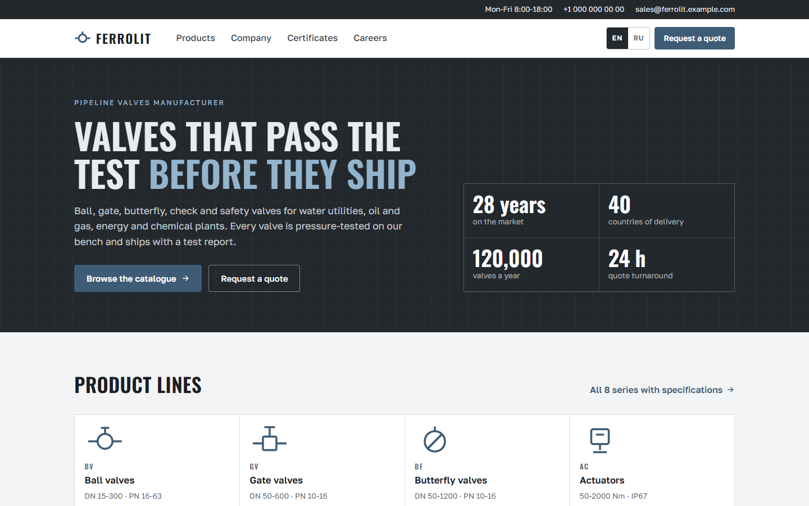

# B2B site for an industrial valve plant

A valve plant: catalogue with technical filters and a quote request built straight from it.

**Live:** https://dmitrii-mazurkevich.github.io/b2b-manufacturer-website/

## Built with

HTML, CSS, JavaScript, Schema.org Organization. Static site without a build step: open `index.html` or publish the folder to any hosting.
English and Russian versions with a language switcher, layout for phones and desktops.

## Author

Made by Dmitrii Mazurkevich: websites, WordPress and WooCommerce, analytics and AI automation.
Telegram https://t.me/dmitrii_pjm · dmitrymazurkevichse@gmail.com · [all works](https://dmitriiwebcraft.com)
